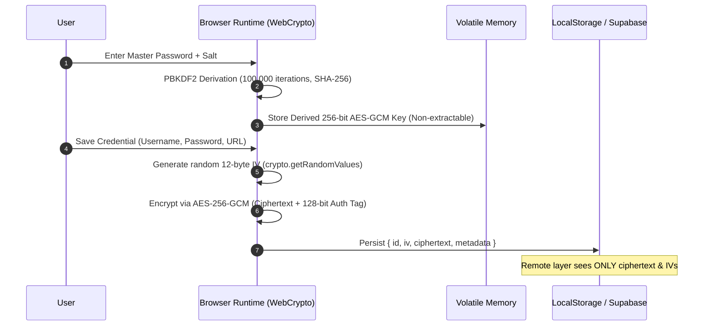

<div align="center">
  <h1>vault-password-manager</h1>
  <p>Zero-knowledge client-side password vault with WebCrypto AES-256-GCM encryption, PBKDF2 key derivation, and offline persistence.</p>

  <p>
    <a href="https://github.com/itsgoharrehman/vault-password-manager/releases"></a>
    <a href="LICENSE"></a>
    
    
    <a href="https://github.com/itsgoharrehman/vault-password-manager/stargazers"></a>
    <a href="https://github.com/itsgoharrehman/vault-password-manager/issues"></a>
  </p>
</div>

---

## Overview

Vault is a zero-knowledge password management web application designed to run entirely client-side. Cryptographic operations are executed locally within the browser runtime using the W3C WebCrypto API. Unencrypted passwords, notes, and master keys are never transmitted over the network or persisted to external databases.

The system supports offline persistence via local storage caching and optional encrypted synchronization with a Supabase database instance. Remote storage stores only ciphertext, initialization vectors (IVs), and authentication tags; master keys and decrypted plaintext remain strictly in client volatile memory.

## Architecture and Cryptographic Pipeline



### Cryptographic Primitives

| Component | Specification | Description |
| :--- | :--- | :--- |
| **Key Derivation** | PBKDF2-HMAC-SHA256 | 100,000 iterations with a cryptographically random per-user salt. |
| **Symmetric Cipher** | AES-256-GCM | Authenticated encryption providing confidentiality and integrity verification. |
| **Initialization Vector (IV)** | 12-byte (96-bit) IV | Generated via `window.crypto.getRandomValues()`. Never reused across encryptions. |
| **Authentication Tag** | 128-bit GCM Tag | Appended to ciphertext; guarantees tamper detection before decryption attempts. |
| **Memory Isolation** | Non-extractable `CryptoKey` | Cryptographic keys cannot be serialized or exported via JavaScript inspection. |

## Data Storage Model

Encrypted records are represented by the following schema both in local cache and in the PostgreSQL/Supabase backing store:

```sql
CREATE TABLE vault_items (
    id UUID PRIMARY KEY DEFAULT gen_random_uuid(),
    user_id UUID REFERENCES auth.users(id) ON DELETE CASCADE,
    title TEXT NOT NULL,
    username_enc TEXT NOT NULL,
    password_enc TEXT NOT NULL,
    url TEXT,
    notes_enc TEXT,
    iv TEXT NOT NULL,
    created_at TIMESTAMPTZ DEFAULT NOW(),
    updated_at TIMESTAMPTZ DEFAULT NOW()
);
```

All fields ending with `_enc` store Base64-encoded ciphertext produced by the WebCrypto AES-GCM cipher.

## Prerequisites

* Modern browser with full W3C WebCrypto support (Chrome 37+, Firefox 34+, Safari 11+, Edge 79+).
* Node.js 18+ (required only for building or serving locally via `build.js`).
* Optional: Supabase account for remote cloud synchronization.

## Installation and Quickstart

### 1. Clone the Repository

```bash
git clone https://github.com/itsgoharrehman/vault-password-manager.git
cd vault-password-manager
```

### 2. Configure Environment

Copy the example configuration file:

```bash
cp js/config.example.js js/config.js
```

Edit `js/config.js` with your Supabase credentials (leave blank for local-only offline mode):

```javascript
window.SUPABASE_URL = "https://your-project.supabase.co";
window.SUPABASE_PUBLISHABLE_KEY = "your-anon-key";
```

### 3. Build and Serve

Build the distribution assets:

```bash
node build.js
```

Serve using any static web server:

```bash
# Python
python -m http.server 8080

# Node.js
npx serve .
```

Open `http://localhost:8080` in your browser.

## Security Considerations and Invariants

* **Client Boundary**: Encryption and decryption occur strictly on the user's device. No plaintext credential ever leaves the client runtime.
* **IV Freshness**: A fresh 12-byte IV is generated for every individual encryption operation. IV reuse is cryptographically prohibited.
* **Memory Management**: Sensitive plaintext strings are dereferenced upon vault locking, leaving only garbage-collectible references.
* **Zero Analytics / Telemetry**: Vault contains zero third-party trackers, external fonts, or telemetry scripts that could exfiltrate keystrokes.

## Testing and Verification

* **Cryptographic Round-Trip Test**: Encrypts and decrypts test payloads against known vector outputs.
* **Tamper Proofing**: Verifies that any bit-flip in the ciphertext causes `crypto.subtle.decrypt` to reject with an `OperationError`.
* **Zero Plaintext Leakage**: Asserts network tab payloads contain zero unencrypted string matches.

## License and Security Contact

This project is licensed under the [MIT License](LICENSE).

For responsible vulnerability reporting, please review the [Security Policy](SECURITY.md) or contact `goharrehmanfsd260@gmail.com`.